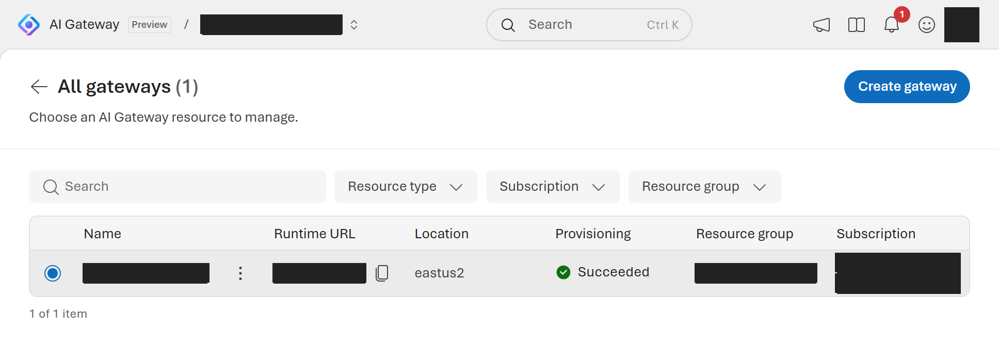
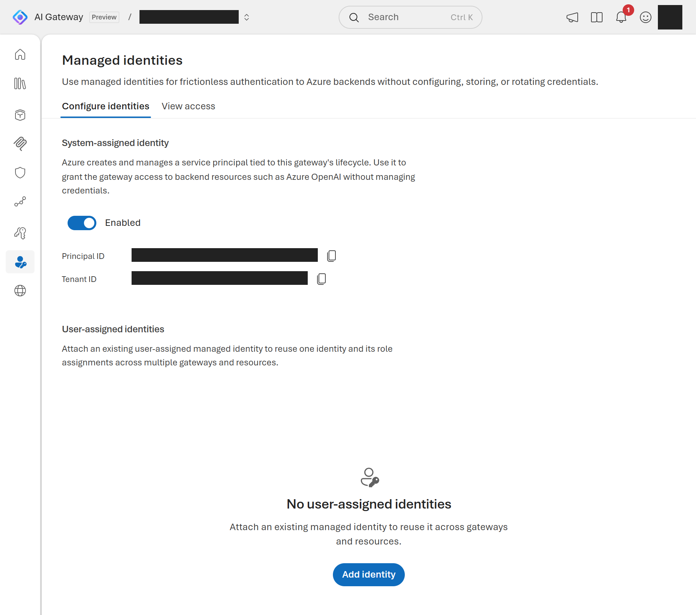
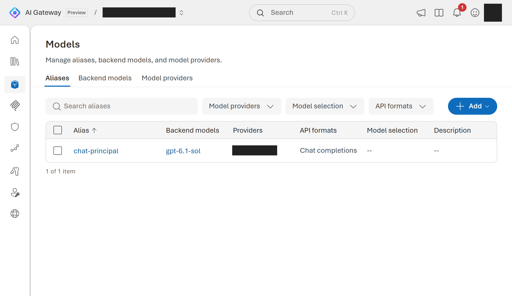
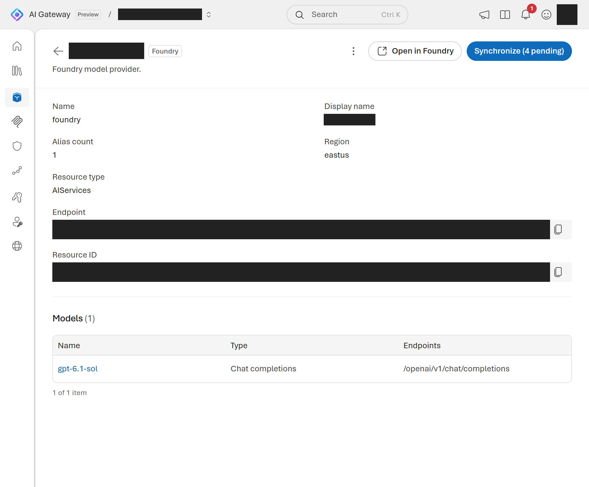
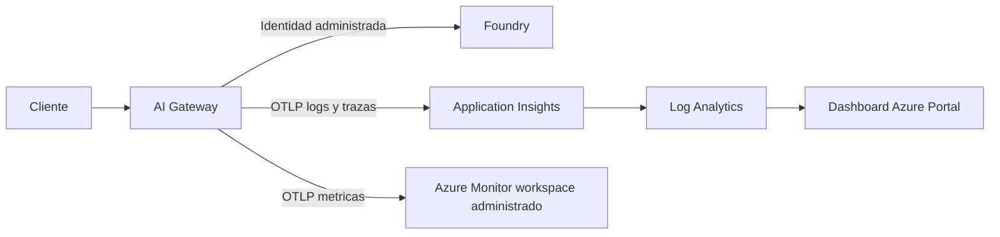
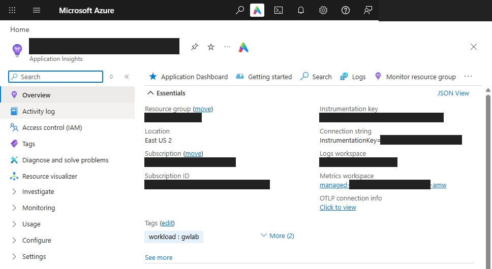
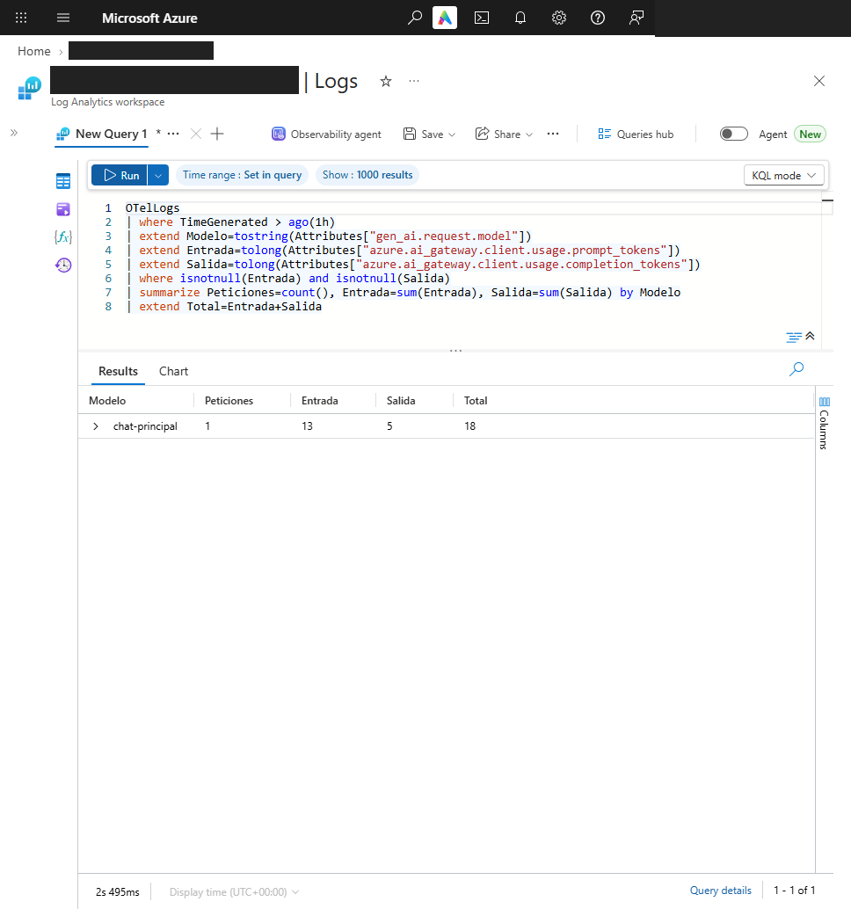
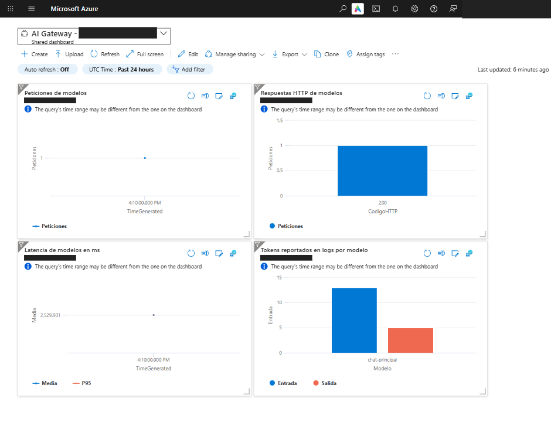

# AI Gateway en Azure: pruebas verificables y observabilidad reproducible

Por [jmfloreszazo](https://github.com/jmfloreszazo).

Que un modelo responda no demuestra que la petición haya pasado por el gateway previsto,
que la credencial esté limitada al gateway o que el backend servido sea el esperado.
Este laboratorio comprueba esas fronteras con una infraestructura real, tres clientes y resultados conservados.
El repositorio incorpora además plantillas de Application Insights, Log Analytics y un dashboard
para reproducir el ejemplo en otra suscripción. El código se comparte en
[GitHub](https://github.com/jmfloreszazo/ai-gateway-preview-lab) con licencia MIT, sin ZIP ni credenciales del autor.

La ejecución descrita es del **9 de noviembre de 2026**. Las capturas son del portal real:
los rectángulos opacos ocultan identificadores y datos de cuenta, no errores ni resultados de las pruebas.
No se han sustituido los recursos del portal por ejemplos dibujados.
La observabilidad se añadió después de la ejecución original y se desplegó también el 9 de noviembre.
Sus tres capturas y su resumen de ejecución se conservan por separado: no sustituyen ni reescriben
la evidencia original de 473 tokens.

## Una pieza nueva sobre un backend existente

El punto de partida fue una cuenta Foundry con modelos ya desplegados. El laboratorio añadió un
recurso `Microsoft.ApiManagement/aigateways`, su identidad administrada, un proveedor Foundry,
un registro de modelo, un alias y una clave temporal. No creó otra cuenta Foundry ni otros despliegues de modelo.

La previsualización inicial, anterior a la ampliación de observabilidad, devolvió **seis creaciones,
cero modificaciones y cero borrados**. No es el recuento esperado de la plantilla actual.
La cuenta Foundry y su proyecto aparecían como `Ignore`. La separación entre las dos plantillas del
repositorio importa: una crea un backend nuevo; la otra referencia el existente.

La región del gateway fue East US 2; la del backend, East US. La captura conserva las regiones
porque forman parte de la configuración técnica, pero no publica el hostname utilizable del laboratorio.

## Dos autenticaciones, dos responsabilidades

La aplicación presenta una credencial de runtime del gateway. El gateway se autentica hacia Foundry
mediante identidad administrada y una asignación de rol acotada a esa cuenta.
La aplicación no necesita una clave de Foundry.

En el recurso probado, la clave de runtime se envió como `Authorization: Bearer`.
No hay que extrapolar ese contrato al tier anterior de API Management, que usaba `api-key`.
Los clientes del repositorio separan ambos modos y no envían los dos headers a la vez.

El rol utilizado hacia el backend fue `Foundry User`. Es el recomendado por el producto,
pero no equivale a un permiso exclusivo de inferencia. El ámbito de la asignación importa tanto como el nombre del rol.
La captura de identidad demuestra que está habilitada; no debe confundirse con una captura de todas sus asignaciones de acceso.

## El alias no es el identificador de respuesta

El alias publicado fue `chat-principal`. El backend registrado fue `gpt-6.1-sol` y la respuesta
identificó `gpt-6.1-sol-2026-09-29`. Comparar directamente el alias con ese último campo habría
producido un falso aviso de fallback.

La prueba usa dos valores distintos: `AI_GATEWAY_MODEL` para el alias solicitado y
`AI_GATEWAY_EXPECTED_MODEL` para el modelo canónico esperado en la respuesta.
Así puede distinguir un alias legítimo de un desvío inesperado sin confiar en el texto generado por el modelo.

El aviso de sincronización pendiente del portal se conserva en la captura. No se pulsó sincronizar:
el alcance del laboratorio era publicar y probar un backend, no importar todo el catálogo existente.

## Cuatro comprobaciones de contrato

El script PowerShell realizó estas comprobaciones contra el gateway:

| Petición | Resultado observado |
|---|---|
| Sin credencial | HTTP 401 |
| Credencial inválida | HTTP 401 |
| Modelo inexistente con credencial válida | HTTP 404 |
| Alias válido con credencial válida | HTTP 200, contenido y uso consistentes |

Las pruebas negativas no sustituyen la comprobación positiva. Un modelo inexistente puede devolver
un error correcto aunque la configuración del backend válido esté rota.
Por eso se exige también una respuesta satisfactoria, el modelo esperado, contenido no vacío y tokens consistentes.

## Tres clientes, 473 tokens

Después del contrato se ejecutaron los clientes C# y Python, sin cambiar el backend ni el alias.

| Cliente | Tokens de entrada | Tokens de salida | Total | Latencia observada |
|---|---:|---:|---:|---:|
| PowerShell | 13 | 5 | 18 | 2.989 ms |
| C# | 29 | 6 | 35 | 2.501 ms |
| Python | 26 | 394 | 420 | 14.735 ms |
| **Total** | **68** | **405** | **473** | |

Son tres peticiones válidas con prompts y respuestas diferentes. Estos tiempos no constituyen
un benchmark entre lenguajes y no permiten atribuir al SDK la diferencia de latencia.
El presupuesto máximo de salida fue de 1024 tokens por petición; no es el consumo real de cada una.

Los resultados están en el [resumen público de ejecución](evidencia/run-summary.json).
Las salidas de [C#](evidencia/dotnet-client.txt) y [Python](evidencia/python-client.txt) se conservan
por separado. La respuesta de Python es contenido generado: sus afirmaciones generales sobre
gobierno no demuestran capacidades ni políticas habilitadas en este gateway.

## Del uso por petición a la observabilidad

Leer los tokens en la respuesta permite comprobar una llamada; observar el gateway exige también
recoger y conservar sus señales. La ampliación declara Log Analytics, Application Insights vinculado
a ese workspace y un dashboard compartido de Azure Portal. El gateway exporta con identidad
administrada, sin claves de instrumentación en los clientes.

El siguiente esquema representa la arquitectura desplegada; las capturas reales aparecen más abajo:

La conexión se hace en dos pasos, siguiendo el
[laboratorio oficial de monitorización](https://github.com/Azure/aigateway/tree/main/labs/13-monitoring).
El primero crea los destinos y activa `AzureMonitorWorkspaceIngestionMode`. Azure prepara después
los endpoints OTLP y una Data Collection Rule en un grupo administrado. Antes del segundo paso,
la identidad del gateway necesita `Monitoring Metrics Publisher` sobre esa regla.
La asignación se realiza por CLI o desde el asistente del portal, porque el grupo administrado
bloquea los despliegues ARM en ese ámbito. Solo entonces se despliega
[el exportador OpenTelemetry](../infra/gateway-telemetry.bicep).

Crear Application Insights sin conectar el exportador no demuestra que se esté recogiendo telemetría.
La configuración deja `payloadCapture: false`, deshabilita la autenticación local de Application
Insights y no añade claims de identidad. Los metadatos técnicos siguen necesitando permisos
y retención adecuados.

El [módulo de observabilidad](../infra/modules/observability.bicep) define cuatro paneles de 24 horas:

| Panel | Datos utilizados | Límite de interpretación |
|---|---|---|
| Peticiones | Spans `Server` de rutas de modelos en `OTelSpans` | No suma spans hijos como llamadas nuevas. |
| Códigos HTTP | Estado de respuesta en `OTelSpans` | Describe respuestas observadas, no todas las causas de error. |
| Latencia | Media y P95 de `DurationMs` | No es un benchmark entre modelos o SDK. |
| Tokens por modelo | Entrada y salida reportadas en `OTelLogs` | Excluye registros sin uso completo; desconocido no significa cero. |

Las métricas OTLP de tokens y coste estimado se almacenan aparte, en el Azure Monitor workspace
administrado vinculado a Application Insights. No se debe buscar ese flujo en `AppMetrics` ni
confundir el panel basado en logs con la facturación de Azure. El dashboard integrado del portal
de AI Gateway puede utilizar las tres señales una vez configuradas.

Los valores por defecto son 30 días de retención de logs y 1 GB de ingesta diaria, parametrizables.
El límite puede excederse y detener la recogida; no limita el gasto de métricas, gateway o inferencia.
Para verificar la ampliación hay que enviar tráfico nuevo, esperar la ingesta y comprobar
`OTelSpans` y `OTelLogs`. Las respuestas históricas de este artículo no se ingieren retroactivamente.

### Capturas reales de observabilidad

Tras aprobar expresamente los costes, se desplegaron los destinos y el dashboard en East US 2.
El `what-if` del módulo mostró tres creaciones, cero modificaciones y cero borrados.
Después se verificó la asignación del rol sobre la DCR y se desplegó el exportador OpenTelemetry.
Los dos despliegues finalizaron en `Succeeded`, sin redeplegar Foundry, sus modelos o el gateway.

La configuración real confirmó las tres señales OTLP, identidad administrada, autenticación local
deshabilitada en Application Insights y `payloadCapture: false`. Azure creó el workspace de métricas,
la DCR y el endpoint de recogida en un grupo administrado.

Para verificar la ingesta se hizo **una sola inferencia nueva**, a las **16:10:13 UTC**.
Respondió HTTP 200 con el modelo esperado y contenido no vacío. La consulta del workspace confirmó
un registro en `OTelLogs` y siete spans en `OTelSpans`; solo uno era un span de servidor de la petición.

| Comprobación de la ampliación | Resultado observado |
|---|---|
| Peticiones de modelo | 1, HTTP 200 |
| Modelo servido | `gpt-6.1-sol-2026-09-29` |
| Tokens de entrada / salida / total | 13 / 5 / **18** |
| Latencia del cliente PowerShell | 9.734 ms |
| Duración del span de servidor | Aproximadamente 2.530 ms |

La latencia del cliente y la duración del span miden fronteras distintas; no son valores intercambiables.
Estos 18 tokens pertenecen a la ampliación y no se han sumado a la tabla histórica de 473 tokens.

Las cuatro gráficas se revisaron en el portal y se guardaron recortadas y anonimizadas, sin alterar
sus datos. El aviso de intervalo se conserva: las consultas fijan `ago(24h)`. Con una única petición,
media y P95 coinciden; esta captura no constituye una prueba de rendimiento ni de fiabilidad estadística.

El [resumen público de observabilidad](evidencia/observability-summary.json) conserva la configuración,
las verificaciones y los resultados sin nombres, IDs, endpoints ni credenciales del entorno.
Se verificó la ingesta de logs y trazas; el exportador de métricas quedó configurado, pero no se presenta
una consulta PromQL ni una conciliación de facturación como verificadas.

## Lo que la vista previa obligó a comprobar

El servicio real exigió SKU `Standard`, aunque un ejemplo consultado utilizaba otro valor.
La raíz aceptó API `2026-11-01`, mientras la configuración hija se completó con `2025-09-01-preview`.
Bicep compiló con avisos `BCP081`: sin tipos locales, compilar no validaba todas las propiedades.

La caducidad de la clave tuvo otra particularidad: la API probada conservó el día y descartó la hora.
Se revisó la fecha devuelta y se aprobó explícitamente la siguiente medianoche UTC.
No conviene presentar como límite de ocho horas lo que el servicio no ha aplicado así.

El portal de AI Gateway también exigió una cuenta organizativa de Microsoft Entra. La cuenta personal
que funcionaba en Azure CLI fue rechazada por ese inicio de sesión web. Las cuatro capturas originales
se tomaron después con una cuenta organizativa y acceso Lector al grupo, sin roles administrativos.
Las tres capturas nuevas de observabilidad se tomaron en Azure Portal; son sesiones y permisos distintos.

## Qué está probado y qué no

Quedaron comprobados el despliegue, las fronteras de autenticación, el alias, el backend servido
y la contabilidad de tokens. Las pruebas locales registradas fueron 25 de .NET, siete de Python
y nueve casos simulados de PowerShell; no deben confundirse con las tres inferencias reales.

La ejecución original no añadió Application Insights ni Log Analytics. La ampliación actual compila
y dispone de diez comprobaciones locales del ARM generado: vinculación al workspace, límites de logs,
cuatro paneles, exportación OTLP, identidad administrada y captura de payloads desactivada.
Las pruebas locales no acreditan por sí solas despliegue remoto ni ingesta. A ellas se añadieron
validación remota, revisión de políticas y `what-if`, verificación del rol real, despliegues satisfactorios,
una inferencia nueva, consultas de logs y trazas y revisión visual de los cuatro paneles.
Las cuatro capturas y los 473 tokens originales se mantienen separados de las tres capturas nuevas y sus 18 tokens.

Tampoco se probaron carga, rendimiento sostenido, fallback,
aislamiento entre consumidores, seguridad de una configuración de producción ni equivalencia con APIM clásico.
Checkov no estaba instalado; esa revisión no se presenta como superada.

El precio del gateway no quedó confirmado. Inferencia, ingesta, retención y métricas pueden generar cargos.
El alcance de una clave de runtime es el gateway: no se debe describir como si restringiera por sí sola el acceso a un alias.

## Reproducir sin publicar tu entorno

El [README](../README.md) contiene los comandos y las dos rutas de despliegue.
Los parámetros distribuidos usan nombres de ejemplo; los valores reales deben quedar en archivos locales ignorados.
Antes de aplicar cambios, revisa tenant, suscripción, grupo, disponibilidad de modelo, permisos, coste y `what-if`.

El ejemplo se publica en [jmfloreszazo/ai-gateway-preview-lab](https://github.com/jmfloreszazo/ai-gateway-preview-lab).
Cualquier persona puede clonar o hacer fork, instalar los requisitos y sustituir los parámetros por los de su entorno.
Los scripts no generan ZIP ni publican en GitHub. El control de revisión es de solo lectura:
no reescribe las evidencias ni crea manifiestos.

Versiona código, pruebas, estas capturas y evidencia saneada, pero no planes privados, claves,
parámetros reales ni salidas de despliegue. El [README](../README.md#publicación) explica las exclusiones
y la revisión con Git. Las imágenes originales se revisaron visualmente además de pasar las
comprobaciones automáticas; las tres nuevas recibieron también revisión visual y enmascarado de datos privados.

Al terminar, revoca la clave temporal y elimina únicamente los recursos y permisos creados para el laboratorio.
La caducidad de una clave no elimina el gateway ni detiene necesariamente sus posibles cargos.
Si añades observabilidad, elimina primero el exportador y después el dashboard y los destinos que
sean exclusivos del laboratorio; comprueba también los recursos y permisos administrados de OTLP.
No borres un grupo que contenga Foundry u otros recursos compartidos.

## Referencias

- [Cambio de recurso y migración de AI Gateway](https://learn.microsoft.com/azure/ai-gateway/ai-gateway-resource).
- [Observabilidad de AI Gateway](https://ai.gateway.azure.com/docs/observability).
- [Laboratorio oficial de monitorización y consultas OTLP](https://github.com/Azure/aigateway/tree/main/labs/13-monitoring).
- [Tipos de cuenta admitidos por Microsoft identity platform](https://learn.microsoft.com/entra/identity-platform/v2-supported-account-types).
- [Código, reproducción y límites del laboratorio](../README.md).