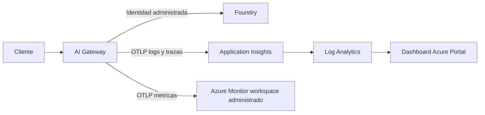

# Probando AI Gateway con Foundry y Azure Monitor

Por [jmfloreszazo](https://github.com/jmfloreszazo).

Ya tenía una cuenta de Foundry con modelos desplegados. Para esta prueba añadí un AI Gateway
por delante y lo llamé desde PowerShell, C# y Python. Me interesaba comprobar la autenticación,
qué modelo atendía cada llamada y cuántos tokens consumía. Después conecté Application Insights
y Log Analytics para ver esas mismas peticiones en un dashboard.

Las pruebas son del **9 de noviembre de 2026**. He ocultado los nombres e identificadores del
entorno en las capturas. El código y las plantillas Bicep están en
[GitHub](https://github.com/jmfloreszazo/ai-gateway-preview-lab), con licencia MIT.

## Reutilizar los modelos de Foundry

Desplegué un recurso `Microsoft.ApiManagement/aigateways` con identidad administrada, un proveedor
Foundry, un registro de modelo, un alias y una clave temporal. Reutilicé la cuenta y el despliegue
que ya tenía, sin crear otro backend.

En ese primer despliegue, todavía sin observabilidad, el `what-if` mostró **seis creaciones,
cero modificaciones y cero borrados**. Foundry y su proyecto aparecían como `Ignore`.
El repositorio tiene una plantilla para este caso y otra para quien necesite crear Foundry desde cero.

El gateway quedó en East US 2 y el backend en East US.

## Autenticación del cliente y del backend

La aplicación presenta una credencial de runtime del gateway. El gateway se autentica hacia Foundry
mediante identidad administrada y una asignación de rol acotada a esa cuenta.
La aplicación no necesita una clave de Foundry.

La clave de runtime se envía como `Authorization: Bearer`. Es un cambio respecto al tier anterior
de API Management, que usaba `api-key`; los clientes del repositorio permiten elegir entre ambos modos.

El rol utilizado hacia el backend fue `Foundry User`. Es el recomendado por el producto,
pero sus permisos van más allá de la inferencia. Lo asigné únicamente sobre la cuenta Foundry.

## El alias y el modelo servido

El alias publicado fue `chat-principal`. El backend registrado fue `gpt-6.1-sol` y la respuesta
identificó `gpt-6.1-sol-2026-09-29`. Comparar directamente el alias con ese último campo habría
producido un falso aviso de fallback.

La prueba usa dos valores distintos: `AI_GATEWAY_MODEL` para el alias solicitado y
`AI_GATEWAY_EXPECTED_MODEL` para el modelo canónico esperado en la respuesta.
La comparación se hace con los metadatos de la respuesta, no con lo que el modelo diga sobre sí mismo.

Registré un solo despliegue, sin sincronizar el resto del catálogo de la cuenta.

## Pruebas de acceso

El script PowerShell realizó estas comprobaciones contra el gateway:

| Petición | Resultado observado |
|---|---|
| Sin credencial | HTTP 401 |
| Credencial inválida | HTTP 401 |
| Modelo inexistente con credencial válida | HTTP 404 |
| Alias válido con credencial válida | HTTP 200, contenido y uso consistentes |

La llamada válida también comprueba el modelo servido, que haya contenido y que los tokens
de entrada y salida sumen el total devuelto por la API.

## Resultados con PowerShell, C# y Python

Después del contrato se ejecutaron los clientes C# y Python, sin cambiar el backend ni el alias.

| Cliente | Tokens de entrada | Tokens de salida | Total | Latencia observada |
|---|---:|---:|---:|---:|
| PowerShell | 13 | 5 | 18 | 2.989 ms |
| C# | 29 | 6 | 35 | 2.501 ms |
| Python | 26 | 394 | 420 | 14.735 ms |
| **Total** | **68** | **405** | **473** | |

Los prompts y las respuestas eran distintos, así que estos tiempos no sirven para comparar SDK.
En las tres llamadas configuré un máximo de 1024 tokens de salida; el consumo real es el de la tabla.

Los resultados están en el [resumen público de ejecución](evidencia/run-summary.json).
Las salidas de [C#](evidencia/dotnet-client.txt) y [Python](evidencia/python-client.txt) se conservan
por separado.

## Añadir observabilidad

Después de probar los clientes añadí Log Analytics, Application Insights vinculado a ese workspace
y un dashboard de Azure Portal. La telemetría sale del gateway con su identidad administrada;
no tuve que añadir instrumentación a los clientes.

El recorrido queda así:

Para conectarlo seguí los dos pasos del
[laboratorio oficial de monitorización](https://github.com/Azure/aigateway/tree/main/labs/13-monitoring).
El primero crea los destinos y activa `AzureMonitorWorkspaceIngestionMode`. Azure prepara los
endpoints OTLP y una Data Collection Rule en un grupo administrado. Después asigné a la identidad
del gateway el rol `Monitoring Metrics Publisher` sobre esa regla y desplegué
[el exportador OpenTelemetry](../infra/gateway-telemetry.bicep).

La asignación del rol se hace por CLI o desde el portal, porque el grupo administrado bloquea
los despliegues ARM en ese ámbito. Hasta conectar el exportador, los destinos no reciben datos.

Dejé `payloadCapture: false` para no registrar prompts ni respuestas y deshabilité la autenticación
local de Application Insights. Tampoco añadí claims de identidad a la telemetría.

El [módulo de observabilidad](../infra/modules/observability.bicep) define cuatro paneles de 24 horas:

| Panel | Datos utilizados | Qué muestra |
|---|---|---|
| Peticiones | Spans `Server` de rutas de modelos en `OTelSpans` | Número de llamadas, sin contar los spans internos como peticiones nuevas. |
| Códigos HTTP | Estado de respuesta en `OTelSpans` | Distribución de respuestas por código. |
| Latencia | `DurationMs` | Media y P95 por intervalo. |
| Tokens por modelo | Uso reportado en `OTelLogs` | Entrada y salida de los registros que incluyen ambos valores. |

Las métricas OTLP de tokens y coste estimado se almacenan aparte, en el Azure Monitor workspace
administrado vinculado a Application Insights. No llegan a `AppMetrics`. El panel de tokens de
este ejemplo consulta los logs; el portal de AI Gateway también tiene sus propias vistas de monitorización.

Los valores por defecto son 30 días de retención de logs y 1 GB de ingesta diaria, parametrizables.
El límite puede excederse y detener la recogida; no limita el gasto de métricas, gateway o inferencia.

### Una llamada vista desde Log Analytics

Desplegué los destinos y el dashboard en East US 2. El `what-if` de ese módulo mostró tres
creaciones, sin modificaciones ni borrados. Tanto este despliegue como el del exportador
terminaron en `Succeeded`.

Con el exportador conectado hice otra llamada, registrada a las **16:10:13 UTC**. Respondió HTTP 200
y dejó un registro en `OTelLogs` y siete spans en `OTelSpans`. Solo uno de esos spans era de servidor:
seguía siendo una única petición.

| Comprobación de la ampliación | Resultado observado |
|---|---|
| Peticiones de modelo | 1, HTTP 200 |
| Modelo servido | `gpt-6.1-sol-2026-09-29` |
| Tokens de entrada / salida / total | 13 / 5 / **18** |
| Latencia del cliente PowerShell | 9.734 ms |
| Duración del span de servidor | Aproximadamente 2.530 ms |

El tiempo del cliente incluye más que la ejecución registrada en el span, de ahí la diferencia.
Esta llamada consumió otros 18 tokens, además de los 473 de la prueba inicial.

Las consultas fijan `ago(24h)`, por eso aparece el aviso de intervalo en los paneles.
Con una sola petición, la media y el P95 coinciden. Para sacar conclusiones de rendimiento
haría falta una prueba con más tráfico.

La configuración y los resultados de esta segunda prueba están en el
[resumen de observabilidad](evidencia/observability-summary.json).

## Detalles de la vista previa

El servicio real exigió SKU `Standard`, aunque un ejemplo consultado utilizaba otro valor.
La raíz aceptó API `2026-11-01`, mientras la configuración hija se completó con `2025-09-01-preview`.
Bicep compiló con avisos `BCP081`: sin tipos locales, compilar no validaba todas las propiedades.

La API de claves conservó el día de caducidad, pero descartó la hora. La clave temporal quedó
con vencimiento en la siguiente medianoche UTC, por lo que conviene revisar la fecha devuelta
por el servicio en lugar de dar por aplicada la hora solicitada.

Para entrar en el portal de AI Gateway necesité una cuenta organizativa de Microsoft Entra,
aunque la cuenta personal funcionaba en Azure CLI.

## Alcance de la prueba

El ejemplo cubre el despliegue, la autenticación, el alias, el modelo servido, los tokens y su consulta
en Log Analytics. También incluye 25 pruebas de .NET, siete de Python, nueve casos simulados de
PowerShell y diez comprobaciones del ARM de observabilidad.

No hice pruebas de carga, fallback ni aislamiento entre consumidores. Tampoco consulté las métricas
con PromQL o comparé el coste estimado con la factura. Las claves de runtime tienen alcance de gateway,
no de alias, algo a tener en cuenta si se va a compartir entre aplicaciones.

El precio del gateway seguía pendiente de confirmación. A eso hay que añadir inferencia, ingesta,
retención y métricas: conviene revisar los costes antes de dejar el laboratorio encendido.

## Probarlo en tu suscripción

El [README](../README.md) tiene los requisitos y los comandos. Puedes reutilizar un Foundry existente
o crear uno nuevo; los parámetros incluidos son de ejemplo y tendrás que adaptarlos a tu suscripción,
región y modelos disponibles. Revisa el `what-if` antes de desplegar.

Al terminar, elimina el gateway y los recursos de observabilidad que hayas creado para la prueba,
conservando Foundry si lo usas para otras aplicaciones. La caducidad de la clave no elimina los recursos.

## Referencias

- [Cambio de recurso y migración de AI Gateway](https://learn.microsoft.com/azure/ai-gateway/ai-gateway-resource).
- [Observabilidad de AI Gateway](https://ai.gateway.azure.com/docs/observability).
- [Laboratorio oficial de monitorización y consultas OTLP](https://github.com/Azure/aigateway/tree/main/labs/13-monitoring).
- [Tipos de cuenta admitidos por Microsoft identity platform](https://learn.microsoft.com/entra/identity-platform/v2-supported-account-types).
- [Código, reproducción y límites del laboratorio](../README.md).